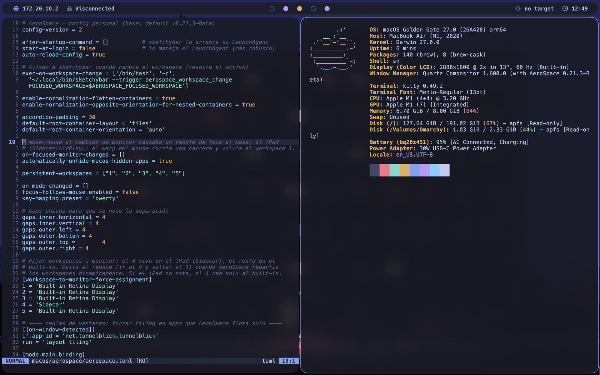
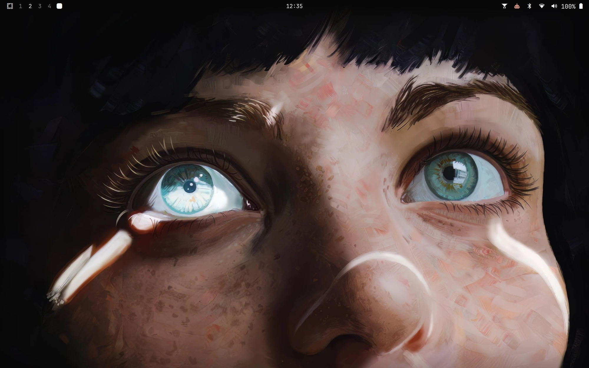
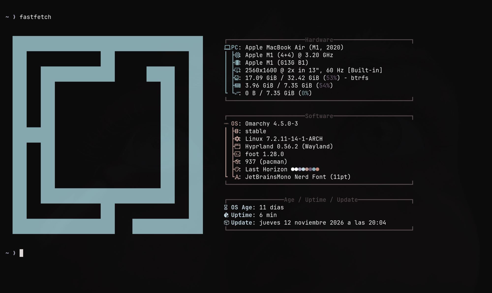

<div align="center">

# bitácora-m1

**Un MacBook Air M1, cuatro intentos y una pregunta:**
**¿se puede tener el hardware de Apple con Linux, sin perder lo cómodo del Mac?**


</div>

## Lo que busco

Apple hace un hardware fantástico. La batería dura el día entero, el trackpad
es el mejor que he usado y la pantalla se ve increíble. Pero yo vivo en Linux:
es donde estudio ciberseguridad, donde resuelvo máquinas, donde entiendo lo que
pasa debajo.

Lo que siempre ando buscando es la combinación: el hardware del Mac, un sistema
Linux, y la comodidad de los atajos de macOS. Copiar con `Cmd + C`, pegar con
`Cmd + V`, mover el trackpad y que responda como en el Mac.

Este repositorio es la bitácora de ese intento. Cada carpeta es una etapa: lo
que armé, lo que funcionó y por qué terminé cambiando.

## Etapa 1 — La máquina virtual

Al principio la única forma de acercarme era con una máquina virtual. Instalé
Arch Linux ARM a mano dentro de VMware Fusion y fui armando un escritorio con
bspwm siguiendo el curso de [S4vitar](https://hack4u.io), entendiendo qué hacía
cada comando en vez de copiar y pegar.

Quedó como quería: barra, menús, temas, atajos. Pero una máquina virtual gasta
batería y se siente invitada en su propia casa. El Linux estaba, pero el Mac
seguía estando encima.

→ [`bspwm/`](bspwm/)

## Etapa 2 — Linux directo en el Mac

Cuando el escritorio estuvo listo, lo llevé al equipo real gracias a
[Asahi ALARM](https://asahi-alarm.org), el Arch Linux ARM para Apple Silicon:
Arch corriendo directo sobre el M1, sin nada en medio.

Ahí hubo que rehacerlo todo en Wayland, con Hyprland, pieza por pieza. Fue la
etapa en la que más aprendí. Hice que `Cmd` fuera la tecla para todo, que
copiar y pegar funcionara igual en cualquier programa, que el trackpad se
comportara como en macOS. Le agregué una barra de laboratorio con la IP, la VPN
y la máquina objetivo siempre a la vista, porque para eso lo uso.

Pero en el día a día no era eficiente. Cerrar la tapa y volver tardaba, y con
tres navegadores abiertos la memoria se acababa. Armar un sistema entero
también significa mantenerlo entero, y cada detalle que faltaba lo tenía que
resolver yo.

→ [`hypr/`](hypr/)

## Etapa 3 — De vuelta a macOS

Entonces probé al revés: en vez de pelear contra el Mac, llevé la experiencia
de Linux encima de macOS. AeroSpace hizo de gestor de ventanas en mosaico,
SketchyBar de barra, y la misma terminal y los mismos temas que usaba en Linux.

Mismo flujo, misma estética, cero máquinas virtuales, cero batería extra.
Funcionaba. Pero seguía siendo macOS, y lo que yo quería era Linux.



→ [`macos/`](macos/)

## Etapa 4 — Omarchy

En septiembre de 2026 Omarchy anunció [Omarchy M](https://omarchy.org/news/2026/09/introducing-omarchy-m/),
un equipo dedicado a que funcione en los Mac con Apple Silicon. Su presentación
decía lo que yo venía pensando desde la primera etapa:

> Apple fabrica un hardware fantástico. Siempre lo han hecho (menos esa única
> vez con el teclado mariposa). Y muchas de las personas que llegan a Omarchy
> llegan desde una Mac. A muchos de ellos les encantaría conservar la máquina y
> perder el sistema operativo. Así que vamos a terminar lo que Asahi comenzó.

Esa persona era yo. Volví a Linux, pero esta vez sin construir todo desde cero:
Omarchy ya trae el escritorio armado, y lo que me toca es ajustar lo que lo
hace sentir Mac. El trackpad con scroll natural y sin tap. La batería limitada
al 80 % para que dure más años. Que se bloquee y suspenda solo. AirDrop con el
iPhone. Un Kali que no se borra al apagar.

Lo que más me sorprendió es que es eficiente, justo lo que me había faltado
en la etapa 2. Bajo la tapa y al abrirla está ahí, al instante. El audio
funciona, el Wi-Fi funciona, y en reposo gasta unos 3 W. Quedan detalles de
Asahi (a veces el Bluetooth o el brillo se traban y hay que despertarlos), pero
son detalles.

<p>
  
  
</p>

<sub>Fondo: tema <a href="https://github.com/HANCORE-linux/omarchy-lasthorizon-theme">Last Horizon</a> de HANCORE.</sub>

→ [`omarchy/`](omarchy/)

## Epílogo — Al final, el Mac

Omarchy respondió la pregunta: sí se puede tener Linux en este hardware, y
bien hecho. Pero cuando lo comparé con el uso de todos los días, la balanza
se fue para el otro lado.

En macOS el M1 rinde lo que promete. La batería dura más, todo despierta al
instante y no queda ningún detalle que haya que despertar a mano. Lo que yo
quería de Linux ya lo tenía en la etapa 3: el mosaico, la barra de
laboratorio, la terminal, los temas y los atajos. Lo que necesito de Linux de
verdad, para estudiar y resolver máquinas, lo corro en un Kali dentro de
[OrbStack](https://orbstack.dev), sin pagarlo en batería.

Así que me quedé con el Mac, con la experiencia de Linux encima. Omarchy sigue
instalado al lado, por si algún día la balanza cambia.

## Lo que aprendí

Cada etapa resolvió algo y dejó otra cosa pendiente. La máquina virtual me
enseñó Linux. Asahi me enseñó Wayland y a armar un sistema completo. macOS me
enseñó que la experiencia importa más que la herramienta. Y Omarchy me enseñó
que no siempre hay que construir todo desde cero: a veces basta con ajustar
bien lo que ya existe.

La pregunta del principio tiene respuesta: sí se puede. Y probarlo me enseñó
otra cosa: a veces la mejor forma de tener Linux en el Mac es llevar lo que te
gusta de Linux al Mac, en vez de reemplazarlo.

---

## Para usarlo

Cada etapa es independiente y tiene su propio README con la instalación, los
atajos y los problemas conocidos.

| Etapa | Carpeta | Sobre qué | Cómo se instala |
|---|---|---|---|
| 1 | [`bspwm/`](bspwm/) | Arch Linux ARM en una máquina virtual | `sh bspwm/instalar.sh` |
| 2 | [`hypr/`](hypr/) | Asahi ALARM Minimal | `curl -fsSL https://raw.githubusercontent.com/braIntelligent/bitacora-m1/main/hypr/preparar.sh \| sh` |
| 3 | [`macos/`](macos/) | macOS (el que uso hoy) | `sh macos/instalar.sh` |
| 4 | [`omarchy/`](omarchy/) | Omarchy en Apple Silicon | `sh omarchy/instalar.sh` |

### macOS en un Mac nuevo

Es el entorno con el que me quedé, así que es el que está más cuidado. Un solo
script lo deja igual en cualquier Mac con Apple Silicon, sin Homebrew:

```sh
git clone https://github.com/braIntelligent/bitacora-m1.git ~/.local/share/bitacora-m1
cd ~/.local/share/bitacora-m1
sh macos/instalar.sh                    # apps, herramientas, config y autostart
sh macos/instalar.sh --kali attacker    # además, Kali en OrbStack con el mismo zsh y nvim
```

Instala AeroSpace, kitty y OrbStack, compila SketchyBar y JankyBorders, baja
las herramientas de terminal con versiones fijas y deja la config **enlazada a
este repo**: lo que cambies en `~/.config` aparece en `git status`, listo para
el commit. Se puede repetir sin romper nada. Lo único que queda a mano es lo
que macOS no deja automatizar (el permiso de Accesibilidad para AeroSpace).
Los detalles y las opciones están en [`macos/`](macos/).

Además, para cualquier etapa:

| Carpeta | Contenido |
|---|---|
| `compartido/` | Terminal y programas: kitty, zsh, tmux, Neovim, yazi, qutebrowser y los temas |
| `extras/` | Opcionales: límite de carga, cortafuegos, instantáneas, LocalSend, NvChad, Caido, certificado del proxy y herramientas de BlackArch |

## Contribuir

Si lo pruebas en otro Mac (un M2, un Pro con pantalla de 120 Hz, un equipo de
escritorio), cuéntame cómo te fue en un *issue*: es justo lo que no puedo
probar. Las correcciones y los temas nuevos son bienvenidos.

## Créditos

Nada de esto existiría sin el trabajo de otras personas:

**Linux en Apple Silicon**
- [Asahi Linux](https://asahilinux.org) y [Asahi ALARM](https://asahi-alarm.org), que hacen posible Linux en estos equipos.
- [Omarchy](https://omarchy.org), creado por [DHH](https://github.com/dhh) y mantenido por [omacom](https://github.com/omacom/omarchy) y su comunidad.
- El equipo de [Omarchy M](https://github.com/omacom/omarchy-mac), por terminar lo que Asahi comenzó.

**Plugins y temas de la comunidad de Omarchy**
- [Trackpad Plus](https://github.com/davefano/omarchy-trackpad-plus) y [Omdrop](https://github.com/netmojo-systems/omdrop-plugin), que hacen que Omarchy se sienta todavía más Mac.
- [HANCORE](https://github.com/HANCORE-linux), autor del tema [Last Horizon](https://github.com/HANCORE-linux/omarchy-lasthorizon-theme) que se ve en las capturas de la etapa 4.
- [z8](https://github.com/yamz8) y [Themotion](https://github.com/yamz8/themotion), las animaciones de los fondos al arrancar y al cambiar de tema.

**Las herramientas de cada etapa**
- [Hyprland](https://github.com/hyprwm/Hyprland), [bspwm](https://github.com/baskerville/bspwm) y [polybar](https://github.com/polybar/polybar) en Linux.
- [AeroSpace](https://github.com/nikitabobko/AeroSpace) de Nikita Bobko, y [SketchyBar](https://github.com/FelixKratz/SketchyBar) y [JankyBorders](https://github.com/FelixKratz/JankyBorders) de Felix Kratz, en macOS.
- [kitty](https://github.com/kovidgoyal/kitty), [fastfetch](https://github.com/fastfetch-cli/fastfetch), [Neovim](https://github.com/neovim/neovim) y [powerlevel10k](https://github.com/romkatv/powerlevel10k) en todas.

**Aprendizaje e inspiración**
- [S4vitar](https://github.com/s4vitar) y su academia [Hack4u](https://hack4u.io): el curso de personalización de Linux que iba siguiendo es el punto de partida de todo esto.
- [gh0stzk](https://github.com/gh0stzk/dotfiles), cuyos diseños de menús inspiraron los de la etapa 2.

## Licencia

[MIT](LICENSE)
