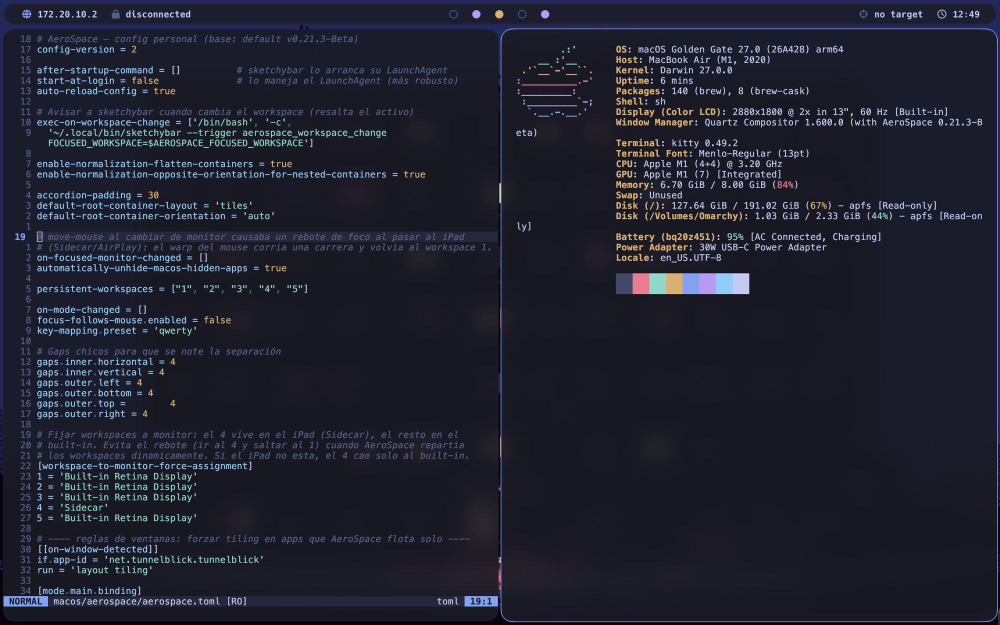

# Etapa 3 — macOS nativo con AeroSpace + SketchyBar

Tercera opción del repo, al lado de la configuración de Linux. La idea de fondo
es la misma de siempre: un tiling WM minimal, una barra propia y una terminal
que se ve igual en todas partes. Lo que cambia es el sistema abajo.

## La historia: VM → ALARM → nativo

1. **VM (Arch ARM en VMware Fusion)** — el punto de partida. Arch Linux ARM
   corriendo virtualizado sobre Apple Silicon, con **bspwm + polybar** (ver la
   carpeta `bspwm/` del repo). Funcionaba, pero una VM gasta batería y se siente
   invitada en su propia casa.
2. **ALARM (Arch Linux ARM nativo / Asahi)** — el intento de correr Arch directo
   sobre el M1. Más cerca del metal, pero el soporte gráfico todavía cojea en
   este hardware y terminó descartado.
3. **macOS nativo con AeroSpace** — la conclusión: en vez de pelear contra el
   Mac, se replica la experiencia de bspwm/polybar **encima de macOS**. Mismo
   flujo, misma estética, cero VM, cero batería extra.

`AeroSpace` hace de tiling WM (el rol de bspwm) y `SketchyBar` de barra (el rol
de polybar). La terminal (`kitty`), el editor (`nvim`), los temas y el `zsh`
vienen de `compartido/`, así que todo se ve igual que en Linux.



## Qué hay acá

| Carpeta | Qué es |
|---------|--------|
| `aerospace/` | `aerospace.toml` — el tiling WM — y `dwindle.sh`, el mosaico en espiral: dos ventanas lado a lado y desde la tercera cada nueva parte a la anterior, alternando horizontal y vertical. Va en `~/.config/aerospace/`. |
| `sketchybar/` | La barra: `sketchybarrc`, `plugins/`, scripts de tema/toggle y las paletas en `themes/`. Va en `~/.config/sketchybar/`. |
| `kitty/` | `kitty.conf` (override macOS: sin barra de título, `Cmd+R` resize de splits) + `base.conf` y `color.ini` (copiados de `compartido/kitty`) + `quick-access-terminal.conf` (el scratchpad). Va en `~/.config/kitty/`. |
| `borders/` | `bordersrc` de **JankyBorders**: borde redondeado en la ventana activa con el color de acento del tema. Va en `~/.config/borders/`. |
| `zsh/` | `zshrc` único para macOS y Kali en OrbStack (lo propio de cada uno va en un bloque), más `lab.zsh` y `p10k.zsh` adaptados a macOS (rutas, BSD sed, pbcopy). |
| `instalar.sh` | El instalador: apps, herramientas, symlinks y autostart (ver abajo). |
| `launchagents/` | Los `.plist` que arrancan AeroSpace, SketchyBar y JankyBorders al login (`~/Library/LaunchAgents/`). |

El editor `nvim` y las paletas base salen de `compartido/` (misma config que en
Linux); acá las paletas se copian además en `sketchybar/themes/` porque es desde
ahí donde las lee `set-theme.sh` en el Mac.

## Instalación

Un solo script, sin Homebrew, para un Mac con Apple Silicon:

```sh
git clone https://github.com/braIntelligent/bitacora-m1.git ~/.local/share/bitacora-m1
cd ~/.local/share/bitacora-m1
sh macos/instalar.sh                    # todo: apps, herramientas, config y autostart
sh macos/instalar.sh --kali attacker    # además crea y enlaza una máquina Kali en OrbStack
sh macos/instalar.sh --solo-config      # solo enlaza la config, no descarga nada
sh macos/instalar.sh --tema rojo        # tema inicial (los de sketchybar/themes)
```

Qué hace, en orden:

1. **Apps** (si faltan): AeroSpace (release de GitHub), kitty (dmg oficial),
   OrbStack, y compila **SketchyBar** y **JankyBorders** de fuente (pide las
   Xcode Command Line Tools si no están; no hace falta desactivar SIP).
2. **Herramientas** como binarios arm64 en `~/.local/bin`: `lsd`, `bat`,
   `zoxide`, `fzf`, `yazi`, `nvim`; **Hack Nerd Font** en `~/Library/Fonts`;
   powerlevel10k, zsh-autosuggestions, zsh-syntax-highlighting y el plugin
   `sudo` de oh-my-zsh (con checksum) en `~/.local/share/zsh/plugins`.
   Todas las versiones van fijas arriba del script.
3. **Config enlazada**: `~/.config/{aerospace,sketchybar,kitty,borders,nvim}`,
   `~/.zshrc`, `~/.p10k.zsh` y `~/.config/lab.zsh` quedan como **symlinks a
   este repo**. Lo que cambies en la config aparece en `git status`; solo falta
   el commit. Lo que ya existía se respalda como `*.bak-FECHA`.
4. **Tema inicial** con `set-theme.sh` (si no había uno aplicado).
5. **Autostart**: instala los `.plist` de `launchagents/` (traen `__HOME__`
   porque launchd no entiende `~`) y los carga con `launchctl bootstrap`.
6. **Kali** (con `--kali NOMBRE`): crea la máquina en OrbStack si no existe y
   enlaza el mismo `zshrc` y `nvim` (OrbStack monta el Mac en `/Users`).

Se puede repetir: lo instalado se salta y lo que ya está bien enlazado no se toca.

**A mano** (macOS no deja automatizarlo): dar permiso de Accesibilidad a
AeroSpace, desactivar "Las pantallas tienen Spaces separados" en Escritorio y
Dock, y copiar los fondos a `~/Pictures/wallpapers`.

Archivos de estado que generan los scripts (`sketchybar/colors.sh`, `mode`,
`target`, `kitty/theme.conf`, `nvim/colors/`) están en `.gitignore`.

`set-theme.sh` recolorea kitty, la barra, nvim y el borde de JankyBorders al
cambiar de tema, así que todo va con el mismo acento.

### Segundo monitor (iPad con Sidecar)

`aerospace.toml` fija el **workspace 1 al iPad** (`secondary`) y el resto a la
pantalla del Mac. El mouse sigue al foco (`on-focus-changed` con
`move-mouse window-lazy-center`), así al saltar entre el Mac y el iPad con el
teclado no hay que arrastrarlo. `wallsync.sh` reaplica el fondo cuando se
conecta o desconecta una pantalla.

### Atajos clave (AeroSpace, modificador `Alt`)

- `Alt+Enter` kitty · `Alt+F` Finder
- `Alt+1..5` workspaces · `Alt+Shift+1..5` mover ventana · `Alt+Tab` workspace anterior
- `Alt+H/J/K/L` foco · `Alt+Shift+H/J/K/L` mover · `Alt+T` tiles/accordion · `Alt+V` horizontal/vertical
- `Alt+R` modo resize · `Alt+Shift+F` fullscreen
- `Alt+M` minimizar · `Alt+Shift+M` restaurar todas · `Alt+B` ocultar barra · `Alt+Shift+B` barra lab/sys
- `Alt+Shift+T` temas · `Alt+Shift+W` wallpapers (selector con preview en vivo)
- `Alt+Shift+Enter` terminal scratchpad

> Teclado **latino**: se evita `/`, `,` y las vocales con Option (son dead keys
> de tildes). Por eso los atajos usan consonantes y `Alt+T`/`Alt+R` en vez de
> `Alt+/`.
